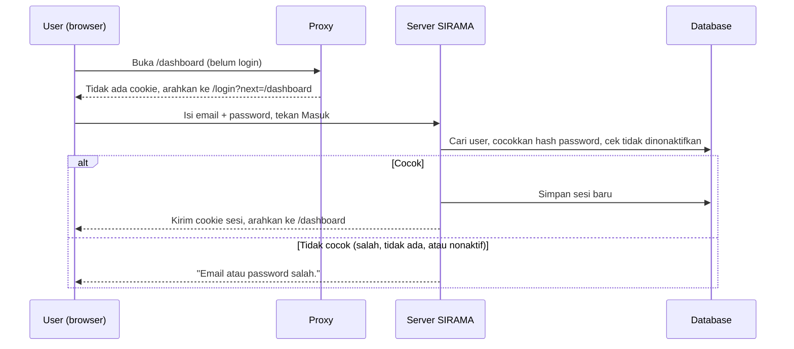

# Penjelasan PR 2: Login dan hak akses

Dokumen ini untuk tim (Haldrian, Calvin, Christian) agar bisa memahami dan menjelaskan PR 2 ke dosen. Detail teknis lengkap ada di [`plans/02-auth.md`](../../plans/02-auth.md), keputusan di [`docs/devlog.md`](../devlog.md) sesi 14, bukti testing di [`docs/testing/`](../testing/README.md) (baris bertanda **PR 2**), dan penjelasan setiap variabel env di [`environment-variable.md`](environment-variable.md).

---

## 1. Tujuan dalam satu kalimat

Setelah PR 2, **SIRAMA hanya bisa dibuka oleh orang yang login**, dan setiap orang hanya melihat serta boleh melakukan apa yang sesuai perannya (Admin, Teknisi, Viewer).

Posisinya di rencana kerja (tech.md §15): PR 1 menyiapkan kerangka kosong, PR 2 memasang "pintu dan kunci", PR 3 dan seterusnya mengisi ruangan (lokasi, rack, device, dan lainnya). Semua halaman berikutnya otomatis terlindungi karena dibangun di dalam pintu ini.

User story yang diselesaikan: **US-AUTH-01** (login) dan **US-AUTH-03** (hak akses dicek di server). US-AUTH-02 (kelola user) menyusul di PR 8.

---

## 2. Apa yang bisa dilihat user

| Yang dilakukan user | Yang terjadi | AC |
|---|---|---|
| Membuka alamat SIRAMA mana pun tanpa login | Dibawa ke halaman login; setelah login dikembalikan ke halaman yang tadi dituju | US-AUTH-01 AC4 |
| Login sebagai Admin atau Viewer | Masuk ke Dashboard | AC1 |
| Login sebagai Teknisi | Masuk ke Tugas saya | AC1 |
| Salah password, email tidak terdaftar, atau akun dinonaktifkan | Pesan yang sama: "Email atau password salah." | AC2, AC3 |
| Mencari halaman daftar akun | Tidak ada; akun hanya dibuat Admin | AC5 |
| Melihat menu | Admin melihat grup Administrasi; Teknisi melihat Tugas saya; Viewer tidak melihat keduanya | US-AUTH-03 AC2 |
| Membuka halaman yang bukan haknya (misalnya Admin membuka Tugas saya) | Halaman "Akses ditolak" (HAL-29) | US-AUTH-03 |
| Membuka alamat yang tidak ada | Halaman "Halaman tidak ditemukan" (HAL-30) | design.md |
| Memakai HP | Sidebar diganti bar navigasi bawah dan menu yang meluncur dari kiri | design.md §5.4 |

Akun demo (dibuat oleh `pnpm db:seed`): `andi@kampus.ac.id` (Admin), `rina@kampus.ac.id` (Teknisi IT), `joko@kampus.ac.id` (Teknisi Fasilitas), `sari@kampus.ac.id` (Viewer).

Halaman Dashboard dan Tugas saya masih berisi judul saja; isinya dibuat di PR 13 dan PR 10.

---

## 3. Cara kerjanya

### Istilah yang dipakai

| Istilah | Artinya |
|---|---|
| **Better Auth** | Pustaka siap pakai untuk login. Kita tidak menulis sendiri kode penyimpanan password dan sesi, karena rawan salah. |
| **Hash password** | Password tidak disimpan apa adanya, tetapi diubah menjadi kode acak satu arah. Bila database bocor, password asli tetap tidak terbaca. |
| **Sesi dan cookie** | Setelah login berhasil, server mencatat "sesi" di database dan memberi browser sebuah cookie (tanda pengenal). Setiap kali membuka halaman, browser mengirim cookie itu sehingga server tahu siapa yang sedang membuka. |
| **Peran (role)** | Admin, Teknisi (technician), Viewer. Disimpan di tabel `user`. |
| **Proxy** | Kode yang berjalan sebelum setiap halaman. Di SIRAMA tugasnya hanya: "tidak ada cookie? arahkan ke login". |
| **Server action** | Fungsi di server yang dipanggil dari form (misalnya tombol Masuk). |
| **Migrasi** | Berkas SQL yang membuat atau mengubah tabel database. Disimpan di `db/migrations/` dan ikut ditinjau di PR. |
| **Seed** | Mengisi database dengan data demo (di PR 2: 4 akun). |
| **Branch database (Neon)** | Salinan database yang bisa dibuat dalam hitungan detik, seperti branch di Git. Dipakai agar pengujian tidak menyentuh data produksi. |

### Alur login

Pesan gagal sengaja dibuat sama untuk semua penyebab. Bila pesannya berbeda ("email tidak terdaftar" vs "password salah"), orang iseng bisa menebak email mana yang terdaftar.

### Hak akses: empat lapis (tech.md §6.2)

1. **Proxy**: tidak ada cookie, dibawa ke login. Ini hanya kenyamanan.
2. **Halaman**: setiap halaman membaca sesi di server (`requireUser`, `requireRole`). Peran salah, tampil "Akses ditolak".
3. **Server action**: setiap aksi yang mengubah data dimulai dengan `authorize(...)`. Ini **lapisan keamanan yang sebenarnya**: walaupun seseorang mengirim permintaan langsung ke server tanpa lewat tombol, permintaannya tetap ditolak (US-AUTH-03 AC1).
4. **Tampilan**: menu dan tombol yang bukan haknya tidak ditampilkan. Ini pelengkap, bukan pengaman.

Menu bahkan dibentuk di server, sehingga menu Administrasi tidak pernah dikirim ke browser Teknisi atau Viewer.

---

## 4. Keputusan yang diambil dan alasannya

Setiap keputusan dibahas dengan pilihan ganda sebelum kode ditulis (plan mode), lalu dicatat di tech.md v0.3 dan devlog.

| Keputusan | Alasan |
|---|---|
| Tabel login dan akun demo dibuat di PR 2 (bukan PR 3) | Login tidak bisa diuji tanpa tabel dan akun. Password akun demo hanya bisa dibuat dengan fungsi hash milik Better Auth. |
| Pengujian otomatis di GitHub (CI) memakai branch database sementara mulai PR 2 | Agar login benar-benar diuji di setiap PR. Branch dibuat, dipakai, lalu dihapus otomatis. |
| Setiap preview Vercel punya branch database sendiri | Sebelumnya preview memakai database produksi, sehingga perubahan tabel dari PR yang belum disetujui bisa merusak data demo. |
| Fitur Cache Components Next.js dimatikan | Hampir semua halaman membaca sesi login; tanpa fitur ini kodenya lebih sederhana dan lebih mudah dijelaskan. |
| Header hanya berisi menu user | Pencarian dan lonceng notifikasi dibuat bersama fiturnya (PR 8, PR 11), agar tidak ada tombol yang belum berfungsi. |
| Menu yang halamannya belum ada tetap tampil | Bentuk menu per peran sudah final dan diuji sekarang; halamannya menampilkan "tidak ditemukan" sampai dibuat. |
| Email demo `@kampus.ac.id` | Mengikuti wireframe halaman login (PRD tidak menyebut email). |

---

## 5. Masalah yang ditemukan dan cara mengatasinya

| Masalah | Cara ditemukan | Penyelesaian |
|---|---|---|
| Proxy tidak berjalan di halaman mana pun (pola alamat salah tulis: satu garis miring terbalik hilang) | Tes E2E "belum login lalu kembali ke tujuan" gagal | Pola diperbaiki; tes sekarang lulus |
| Tombol Keluar di menu desktop tidak bekerja (menu tertutup sebelum form sempat terkirim) | Tes E2E "Keluar mengakhiri sesi" gagal | Tombol memanggil fungsi keluar secara langsung |
| Dua tes integrasi mengisi ulang database bersamaan sehingga bentrok | Tes integrasi gagal acak | Tes integrasi dijalankan berurutan |
| Preview memakai database produksi | Pemeriksaan pengaturan Vercel | Pengaturan "Create Database Branch For Deployment: Preview" diaktifkan; dibuktikan dengan membuat user lewat preview dan memastikan user itu tidak ada di produksi |
| Database lokal (`dev`) ada di project Neon lain (Singapura) | Perbandingan alamat server database | `dev` dipindah menjadi branch di project produksi (Amerika), sesuai tech.md |
| Vercel memakai Node 26, sedangkan lokal dan CI Node 22 | Peringatan di log build | Versi dikunci ke Node 22 |
| Deploy produksi pertama setelah merge gagal ("Invalid URL") | Log build Vercel produksi | `BETTER_AUTH_URL` di Vercel tidak berbentuk URL lengkap. Kode sekarang merapikan nilai itu (menambah `https://`, membuang spasi dan tanda kutip) dan, bila tetap rusak, memakai domain produksi bawaan Vercel. Diuji di `tests/unit/base-url.test.ts`. Situs tidak mati: Vercel tetap menayangkan versi sebelumnya sampai deploy baru berhasil. |

Dua masalah pertama adalah bug sungguhan yang **tertangkap oleh tes otomatis sebelum sampai ke user**. Ini contoh nyata manfaat testing yang bisa diceritakan saat presentasi.

---

## 6. Pengujian

| Jenis | Alat | Jumlah di PR 2 | Yang dibuktikan |
|---|---|---|---|
| Typecheck, lint, format | TypeScript, ESLint, Prettier | Seluruh kode | Kode konsisten dan rapi; `src/domain/` tidak boleh memakai database atau React |
| Unit | Vitest | 164 tes | Aturan peran, halaman awal, menu per peran, keamanan alamat `?next=`, token desain |
| Integrasi | Vitest + database Neon | 19 tes | Login dengan database sungguhan: per peran, password salah, akun nonaktif (sesinya ikut dicabut), pendaftaran ditolak, `authorize` per peran, seed |
| E2E (blackbox) | Playwright | 27 skenario, di desktop dan HP | Aplikasi dipakai seperti user sungguhan; setiap skenario direkam video |

Bukti lengkap (tabel setiap tes, hasil, dan video): [`docs/testing/README.md`](../testing/README.md). Tabel E2E-nya bisa langsung menjadi tabel blackbox testing di Bab IV.

---

## 7. Di mana kodenya

| Bagian | Berkas |
|---|---|
| Konfigurasi Better Auth | `src/server/auth.ts` |
| Tabel database dan migrasi | `src/server/db/schema.ts`, `db/migrations/0000_auth.sql` |
| Proses login (pesan tunggal) | `src/server/sign-in.ts`, `src/server/actions/auth.ts` |
| Pemeriksaan hak akses | `src/server/authz.ts` (`requireUser`, `requireRole`, `authorize`) |
| Proxy | `src/proxy.ts` |
| Aturan peran dan menu (tanpa database, diuji unit) | `src/domain/roles.ts` |
| Halaman login | `src/app/(auth)/login/` |
| Tata letak setelah login | `src/app/(app)/layout.tsx`, `src/components/sirama/` (sidebar, header, bar bawah, menu HP) |
| Halaman ditolak dan tidak ditemukan | `src/app/forbidden.tsx`, `src/app/not-found.tsx` |
| Akun demo | `db/seed/users.ts` |
| Tes | `tests/unit/roles.test.ts`, `tests/integration/auth.test.ts`, `tests/integration/authz.test.ts`, `tests/e2e/auth.spec.ts` |
| Pengujian otomatis di GitHub | `.github/workflows/ci.yml` |

---

## 8. Kronologi pengerjaan

1. **Rencana** (plan mode): membaca PRD, design.md, tech.md; menemukan dua celah urutan PR dan dua masalah (database preview, Cache Components); semuanya diputuskan tim lewat pilihan ganda; rencana ditulis di `plans/02-auth.md` dan disetujui.
2. **Fondasi data**: tabel login, migrasi pertama, akun demo.
3. **Logika login dan hak akses**: Better Auth, proses login, proxy, `requireUser`/`requireRole`/`authorize`.
4. **Tampilan**: halaman login, sidebar, header, bar bawah dan menu HP, halaman ditolak/tidak ditemukan.
5. **Pengujian**: unit, integrasi, lalu E2E. E2E menemukan dua bug yang langsung diperbaiki.
6. **Penyiapan lingkungan**: GitHub Secrets untuk CI, variabel Vercel, seed database produksi, branch database per preview, pemindahan database `dev`, Node 22.
7. **PR #3 dibuka**: CI hijau, preview berjalan dengan database sendiri, login bisa dicoba.

---

## 9. Cara mencoba sendiri

1. Buka preview di PR #3 atau, setelah merge, https://dcmproject.vercel.app.
2. Login dengan salah satu akun demo (password: tanyakan ke Haldrian, sama dengan `SEED_PASSWORD`).
3. Coba: password salah, login per peran, buka `/my-tasks` sebagai Admin, buka alamat asal-asalan, tombol Keluar, dan tampilan HP (DevTools, lebar 375 px).

---

## 10. Pertanyaan yang mungkin diajukan dosen

**Bagaimana password disimpan?** Sebagai hash (scrypt, bawaan Better Auth), tidak pernah sebagai teks asli.

**Kalau tombol hapus disembunyikan, apakah Teknisi masih bisa menghapus lewat cara lain?** Tidak. Setiap aksi di server dicek ulang dengan `authorize`. Menyembunyikan tombol hanya untuk kenyamanan. Ini diuji di tes integrasi `authz.test.ts`.

**Kenapa pesan gagal login selalu sama?** Agar orang tidak bisa menebak email mana yang terdaftar atau akun mana yang dinonaktifkan.

**Bagaimana menonaktifkan user?** Admin menonaktifkan (fitur "ban" Better Auth); semua sesi aktifnya langsung berakhir. Diuji di tes integrasi dan E2E AC3. Halaman kelola user dibuat di PR 8.

**Bagaimana memastikan pengujian tidak merusak data demo?** Pengujian di GitHub dan preview memakai branch database terpisah yang dibuat otomatis lalu dihapus; produksi tidak tersentuh sampai PR di-merge.
